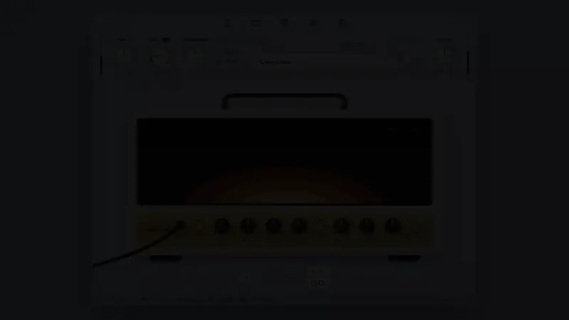

# Kiln — Guitar Plugin Interface

A daily interaction project: the interface of a guitar amp and effects plugin, built as a web app. UI only, no audio.

<p align="center">
  
</p>

<p align="center"><a href="docs/demo.mp4">Watch as a video</a></p>

## Features

- **Five views:** Pedals, Amp (Flint, Cinder, Ember), Cabinet with movable mics, 9-band EQ, and an Echo + Reverb rack
- **Global controls:** input/output, gate, transpose, doubler, and a preset bar with save, revert and duplicate
- **Tools:** tuner, metronome with odd time signatures and accents, and audio settings
- **Linked rig:** the cabinet and EQ follow the selected amp
- **Knobs:** drag (Shift for fine control), scroll, arrow keys, double-click to reset

## Tech stack

React 19, Vite, Tailwind CSS v4

## Getting started

```bash
npm install
npm run dev
```

## Credits

Designed and built by Alan as part of the daily interaction series. Inspired by Neural DSP's plugin design; Kiln is an original concept and not affiliated with Neural DSP.
